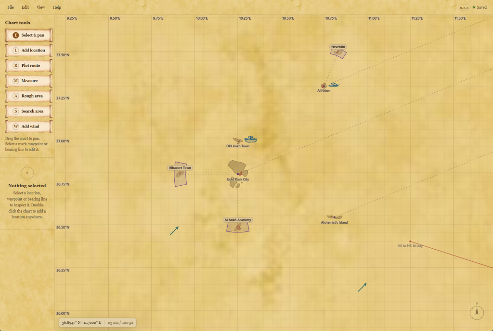
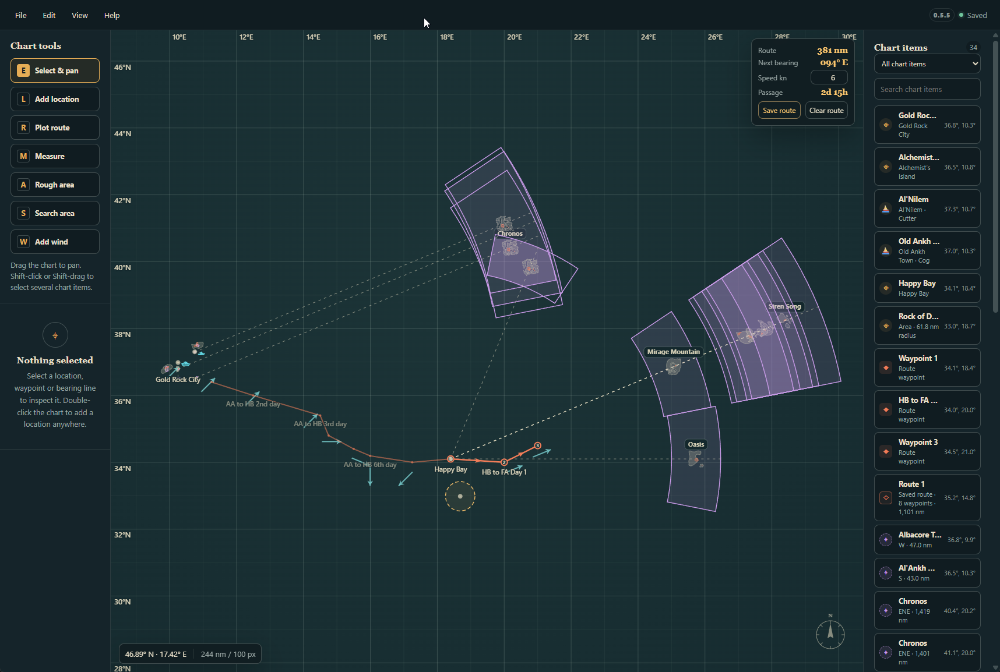

# Sailwind Chartroom

A charting desk for Sailwind. Mark islands, plot and save routes, narrow down islands from mission directions, and load coords from Coordinate Viewer.

## Screenshots

## Install

### Windows

1. Download `SailwindChartroom-<version>.zip` from the [latest release](https://github.com/Skeptic043/sailwind-chartroom/releases/latest) and extract it anywhere.
2. Run `Sailwind Chartroom.exe`.

Needs 64-bit Windows 10 or 11. Chartroom isn't code-signed, so Windows may warn the first time you run it. Choose More info, then Run anyway.

### macOS

1. Download `SailwindChartroom-macos-universal-<version>.zip` from the [latest release](https://github.com/Skeptic043/sailwind-chartroom/releases/latest) and double-click it to unpack.
2. Drag **Sailwind Chartroom** into your Applications folder and open it.
3. macOS will say it can't check the app, because Chartroom isn't signed with an Apple developer account. Click **Done**.
4. Open **System Settings → Privacy & Security**, scroll down to the message about Sailwind Chartroom, click **Open Anyway** and confirm.

Steps 3 and 4 are only needed the first time. Needs macOS 13 or later, on Apple silicon or Intel.

## Updating

Chartroom checks for new versions when it starts and can update itself. You can also use Help > Check for updates, or turn the check off in File > Settings.

## Saved charts

Charts save automatically to `%APPDATA%\Sailwind Chartroom` on Windows and `~/Library/Application Support/Sailwind Chartroom` on macOS, with a copy from your previous launch. Use File > Back up all charts to save a copy.

## Credits

- Island outlines and large amounts of inspiration come from the [Sailwind Web Map](https://github.com/MoffKalast/Sailwind-Map) by MoffKalast and Sycosys/Fizzygig, used under the MIT License. See [THIRD-PARTY-NOTICES.md](https://github.com/Skeptic043/sailwind-chartroom/blob/main/THIRD-PARTY-NOTICES.md).
- The Bottleneck Isle outline is traced from [Better Ports](https://github.com/winterspices/BetterPorts) by winterspices.
- Reads tracks from [Coordinate Viewer](https://github.com/AppSailwindMods/CoordinateViewer).
- Boat markers include boats from [Age of Exploration](https://thunderstore.io/c/sailwind/p/WinterSpicesEnterprises/AgeOfExploration/) and [HMS Leopard](https://github.com/winterspices/HMSLeopard) by winterspices, [Dinghies](https://thunderstore.io/c/sailwind/p/Pr0SkyNesis/Dinghies/) and [Paraw](https://github.com/alesparise/FFLParaw-Sailwind-Mod) by Pr0SkyNesis/alesparise, Old Chronian by Aquilartz, Happy Bay Boat by jazzpirat, and Shattered Seas by [TheOriginOfAllEvil](https://github.com/TheOriginOfAllEvil).
- The Sailwind theme's paper is [old paper](https://opengameart.org/content/old-paper) by Flixberry Entertainment, and its tool scrolls are [Scroll UI Container](https://opengameart.org/content/scroll-ui-container) by Chloe Wolfe, both CC0.
- Chartroom is fan-made and not affiliated with the developers of Sailwind.

## AI Use

AI was used to write all of the code in this project. The idea comes from the Sailwind Web Map; the improvements, design direction, testing, debugging, and release decisions are my own. If you prefer not to use tools developed with AI assistance, I understand and respect that choice.

## Links

[Report an issue](https://github.com/Skeptic043/sailwind-chartroom/issues) · [Source code](https://github.com/Skeptic043/sailwind-chartroom) · [Release notes](https://github.com/Skeptic043/sailwind-chartroom/blob/main/CHANGELOG.md) · [Build instructions](https://github.com/Skeptic043/sailwind-chartroom/blob/main/BUILDING.md) · [License](https://github.com/Skeptic043/sailwind-chartroom/blob/main/LICENSE) · [Support on Ko-fi](https://ko-fi.com/skeptic043) · skeptic043
