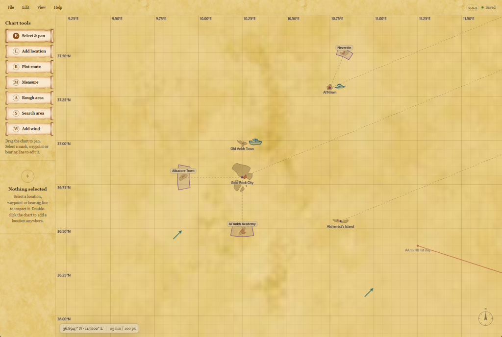
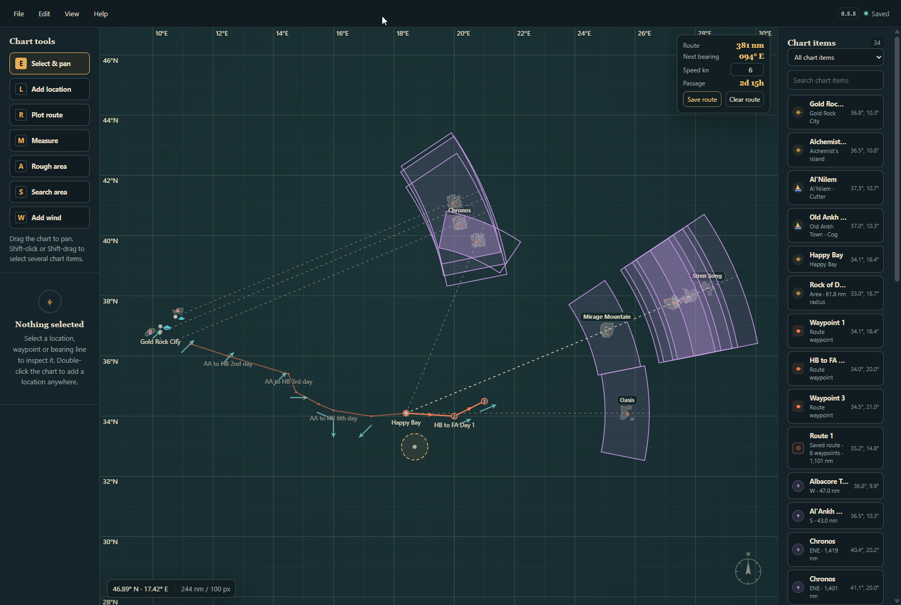

# Sailwind Chartroom

A charting desk for Sailwind. Mark islands, plot and save routes, narrow down islands from mission directions, navigate by dead reckoning, follow your boat live with [Voyage Recorder](https://github.com/Skeptic043/sailwind-voyage-recorder) or Coordinate Viewer, and publish your worlds, routes and races on [Chartroom Voyages](https://skeptic043.github.io/sailwind-chartroom-voyages/).

## Screenshots

## Install

### Windows

1. Download `SailwindChartroom-<version>.zip` from the [latest release](https://github.com/Skeptic043/sailwind-chartroom/releases/latest) and extract it anywhere.
2. Run `Sailwind Chartroom.exe`.

Chartroom needs 64-bit Windows 10 or 11. It is not code-signed, so Windows may warn you the first time it opens. Choose `More info`, then `Run anyway`.

### macOS

1. Download `SailwindChartroom-macos-universal-<version>.zip` from the [latest release](https://github.com/Skeptic043/sailwind-chartroom/releases/latest) and double-click it to unpack.
2. Drag `Sailwind Chartroom` into your `Applications` folder and open it.
3. Because Chartroom is not signed with an Apple developer account, macOS will say it cannot check the app. Click `Done`.
4. Open `System Settings` > `Privacy & Security`, scroll to the message about Sailwind Chartroom, click `Open Anyway`, then confirm.

Steps 3 and 4 are only needed the first time. Chartroom needs macOS 13 or later and runs on Apple silicon or Intel.

## Updating

Chartroom checks for new versions when it starts and can update itself. You can also choose `Help` > `Check for updates`, or turn off automatic checks in `File` > `Settings`.

## Saved charts

Charts are saved automatically in `%APPDATA%\Sailwind Chartroom` on Windows and `~/Library/Application Support/Sailwind Chartroom` on macOS, along with a copy from your previous launch. Choose `File` > `Back up all charts` to save another copy.

## Sharing and racing

[Chartroom Voyages](https://skeptic043.github.io/sailwind-chartroom-voyages/) hosts published worlds, routes, heatmaps and race boards. The `File` menu's `Share and race` commands work with the site: `Publish world/route`, `Publish route as race`, `Enter a race` and `Browse worlds and routes`. Publishing a route or a race also publishes its world if the site doesn't have it yet. Submissions require a GitHub account and are made in your browser. Chartroom only saves the file and opens the correct form.

## Credits

- Island outlines and large amounts of inspiration come from the [Sailwind Web Map](https://github.com/MoffKalast/Sailwind-Map) by MoffKalast and Sycosys/Fizzygig, used under the MIT License. See [THIRD-PARTY-NOTICES.md](https://github.com/Skeptic043/sailwind-chartroom/blob/main/THIRD-PARTY-NOTICES.md).
- The Bottleneck Isle outline is traced from [Better Ports](https://github.com/winterspices/BetterPorts) by winterspices.
- Reads tracks from [Coordinate Viewer](https://github.com/AppSailwindMods/CoordinateViewer) as well as Voyage Recorder.
- Boat markers include boats from [Age of Exploration](https://thunderstore.io/c/sailwind/p/WinterSpicesEnterprises/AgeOfExploration/) and [HMS Leopard](https://github.com/winterspices/HMSLeopard) by winterspices, [Dinghies](https://thunderstore.io/c/sailwind/p/Pr0SkyNesis/Dinghies/) and [Paraw](https://github.com/alesparise/FFLParaw-Sailwind-Mod) by Pr0SkyNesis/alesparise, Old Chronian by Aquilartz, Happy Bay Boat by jazzpirat, and Shattered Seas by [TheOriginOfAllEvil](https://github.com/TheOriginOfAllEvil).
- The Sailwind theme's paper is [old paper](https://opengameart.org/content/old-paper) by Flixberry Entertainment, and its tool scrolls are [Scroll UI Container](https://opengameart.org/content/scroll-ui-container) by Chloe Wolfe, both CC0.
- Chartroom is fan-made and not affiliated with the developers of Sailwind.

## AI Use

AI was used to write all of the code in this project. The idea comes from the Sailwind Web Map; the improvements, design direction, testing, debugging, and release decisions are my own. If you prefer not to use tools developed with AI assistance, I understand and respect that choice.

## Links

[Report an issue](https://github.com/Skeptic043/sailwind-chartroom/issues) · [Source code](https://github.com/Skeptic043/sailwind-chartroom) · [Release notes](https://github.com/Skeptic043/sailwind-chartroom/blob/main/CHANGELOG.md) · [Build instructions](https://github.com/Skeptic043/sailwind-chartroom/blob/main/BUILDING.md) · [License](https://github.com/Skeptic043/sailwind-chartroom/blob/main/LICENSE) · [Support on Ko-fi](https://ko-fi.com/skeptic043) · skeptic043
